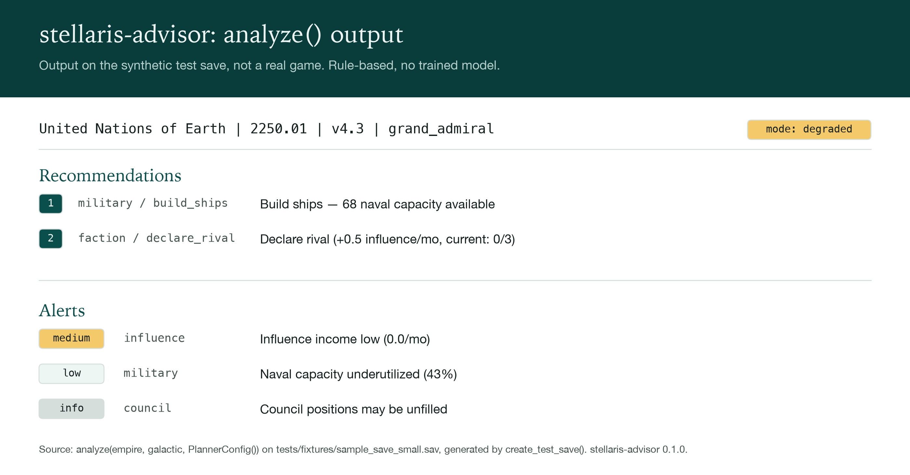
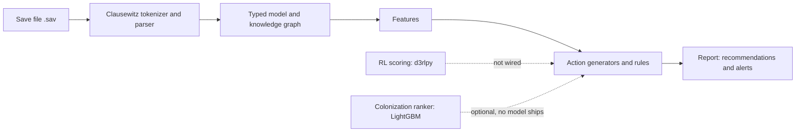

# Stellaris AI Advisor

[](LICENSE)

A rule-based Python library that parses a Stellaris save file and returns ranked recommendations and alerts for the player's empire.



*Real output of `analyze()` on the synthetic test save that the test suite generates. It is not a real game.*

## What it does

- Parses Stellaris `.sav` files with a hand-written Clausewitz tokenizer and recursive-descent parser into typed, frozen dataclasses.
- Loads game definition files into a knowledge graph, including the tech DAG (networkx).
- Extracts 109 empire features, 12 system features and 8 temporal features, and ingests a folder of saves into four Parquet files.
- Ranks actions from 9 rule-based action generators and raises alerts from 12 alert rules.
- Contains offline RL (d3rlpy CQL and IQL) and LightGBM LambdaMART colonization training code. No trained model ships, and the planner does not use them yet (see Status and limits).

## Quickstart

Prerequisites: Python 3.10 or newer, and a clone of this repository (the example uses the test-save generator in `tests/`).

```bash
git clone https://github.com/shifosss/Stellaris-Recommender.git
cd Stellaris-Recommender
python -m venv .venv && source .venv/bin/activate
pip install -e ".[dev]"
```

From the repository root, generate the synthetic save, parse it and run the planner:

```bash
python - <<'EOF'
from tests.fixtures.create_test_save import create_test_save

create_test_save()

from stellaris_advisor.config import PlannerConfig
from stellaris_advisor.parser import parse_save
from stellaris_advisor.planner import analyze

galactic = parse_save("tests/fixtures/sample_save_small.sav")
empire = galactic.player_empire
report = analyze(empire, galactic, PlannerConfig())

print(f"{empire.name} | {galactic.year}.{galactic.month:02d} | v{galactic.game_version} | {galactic.difficulty}")
print("mode:", report.mode)
for rec in report.recommendations:
    print(rec.rank, rec.category, rec.action_type, "-", rec.description)
for alert in report.alerts:
    print(alert.severity.value, alert.category, "-", alert.message)
EOF
```

Output:

```text
United Nations of Earth | 2250.01 | v4.3 | grand_admiral
mode: degraded
1 military build_ships - Build ships — 68 naval capacity available
2 faction declare_rival - Declare rival (+0.5 influence/mo, current: 0/3)
medium influence - Influence income low (0.0/mo)
low military - Naval capacity underutilized (43%)
info council - Council positions may be unfilled
```

The command line only has `version`: running `stellaris-advisor` prints `stellaris-advisor 0.1.0`. There is no `analyze` or `parse` command yet, so use the library as above. Parquet ingestion (`stellaris_advisor.data.ingest.ingest_saves`) and the training code need the ML extra: `pip install -e ".[ml,dev]"`.

## How it works



A `.sav` file is a ZIP archive holding a metadata file and the `gamestate`. The parser turns the Clausewitz text into typed dataclasses (`GalacticState`, empires), and the game files give a knowledge graph. `analyze()` extracts features, generates candidate actions with 9 rule-based generators, ranks them by rule ROI, and checks 12 alert rules. The ML modules are imported lazily, so the rule-based path runs without torch, d3rlpy or LightGBM installed.

## Status and limits

- **No trained model ships.** `analyze()` always returns `mode="degraded"`: RL scoring is not wired into ranking (`planner/report.py:87-88`), and the "full mode" branch in `planner/ranker.py` is a stub. The LightGBM colonization scorer is loaded only if you pass `colonization_model_path`, and none ships.
- **Six advisor modules are not called by `analyze()`.** Council, faction, megastructure, perk, tech and tradition advisors work as library functions you can call yourself. `analyze()` returns `None` for their fields in the report.
- **CLI:** `version` only.
- **Synthetic data only.** Everything above was run on the generated test save. Parsing a real save (5 to 200 MB of `gamestate`, per the PRD in `docs/`) has not been tested. The RL and LightGBM training code was tested on synthetic data only.
- **Benchmarks** use built-in defaults for captain difficulty when no benchmark file is given.
- **Lint:** `ruff check src tests` currently reports 77 errors.

## Testing

```bash
pip install -e ".[ml,dev]"
pytest -m "not slow" --ignore=tests/test_rl
pytest -m "not slow" tests/test_rl
```

Run `tests/test_rl` in its own process. On macOS (arm64, Python 3.12), importing torch and then training a LightGBM model in the same process segfaults (exit 139), and the full suite hits that in `tests/test_colonization`. Not checked on Linux. Together the two commands select 1,224 non-slow tests: 1,223 pass and 1 fails. The `slow` marker (RL training, LightGBM training) is run separately: `pytest -m slow tests/test_rl` and `pytest -m slow tests/test_colonization`.

Known issues:

- `tests/test_rl/test_networks.py::TestValueNetwork::test_output_shape_single` fails: the value network uses BatchNorm and the test feeds a batch of 1 in training mode.
- numpy is missing from the `dev` extra. `tests/test_rl/test_tuning.py` imports it at module level, so `pytest` fails to collect with `.[dev]` alone. Install `.[ml,dev]`, or add `--ignore=tests/test_rl/test_tuning.py` (1,133 passed, 20 skipped on that install).

## License

GNU AGPL v3. See [LICENSE](LICENSE).

## Credits

Stellaris and the Clausewitz save format belong to Paradox Interactive. This project is not affiliated with or endorsed by Paradox Interactive. The repository ships no game files and no real saves; the test fixtures are synthetic stubs generated or written for this repository.
